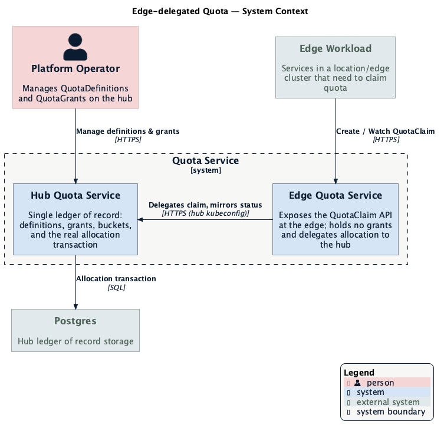
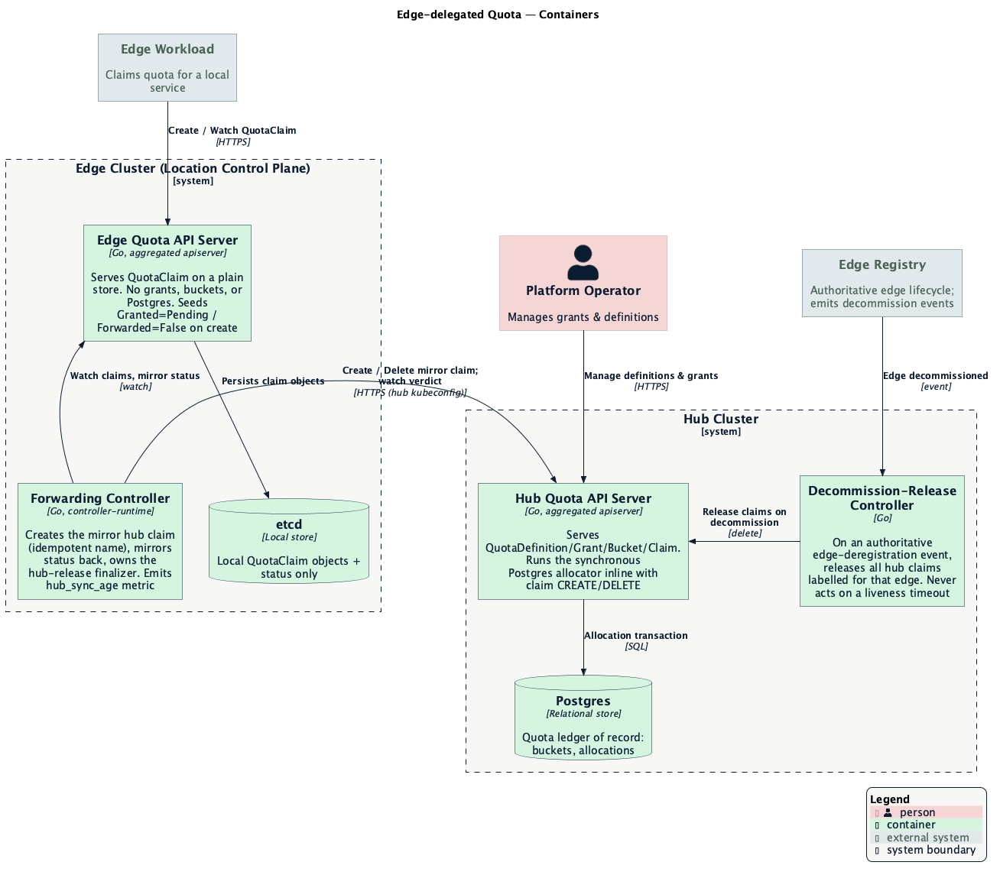

# 0001 - Edge-delegated quota: hub-of-record with delegating edge clusters

- **Status**: Proposed
- **Date**: 2026-06-03
- **Authors**: Quota service maintainers
- **Tracking**: TBD
- **Related**: [ADR 0001 - Dual-backend quota allocation](../adr/0001-postgres-first-architecture.md)

## Summary

Add an **edge deployment profile** to the quota service. A central **hub**
cluster runs the Postgres-backed ledger of record (definitions, grants,
buckets, the real allocation transaction). Multiple **edge** clusters run a
thin quota apiserver that exposes the `QuotaClaim` API to local services but
holds no grants and performs no local allocation. Instead, an **edge
forwarding controller** delegates each claim to the hub, creates a mirror
`QuotaClaim` there, and reflects the hub's verdict back onto the local claim.

This is **Model A (thin delegation)**. It is intentionally the conservative
first step: the hub keeps per-claim accounting and full visibility, and the
edge carries almost no state. A later enhancement (Model B, lease/sub-pool)
can let edges serve claims from a pre-allocated lease while partitioned; this
document scopes only Model A, which degenerates into Model B with the lease
size set to zero.

## Motivation

The quota service today assumes the consumer (control plane) and the ledger
are co-located: a `QuotaClaim` CREATE runs the allocation transaction inline
(Postgres `allocator` mode) or via a reconciler (etcd `controller` mode), and
the answer is local. Edge topologies break that assumption:

- Services run in many **location/edge clusters** that are operationally and
  geographically separate from the control plane.
- A service in an edge cluster needs to claim resources that are governed by a
  **central grant** (e.g. an organization's global allowance), not a per-edge
  allowance.
- We want **one source of truth** for an organization's consumption rather
  than N independent ledgers that can each overspend the same grant.

### Goals

1. A service running in an edge cluster can create a `QuotaClaim` against the
   local apiserver using the **existing API** — no new SDK, no new types in
   the request path.
2. The **hub** is the single ledger of record. All real allocation happens in
   the hub's Postgres transaction; the sum of edge consumption can never
   exceed the hub grant.
3. The edge holds **no grants, no buckets, no Postgres** — it is a delegating
   front-end plus controllers.
4. Allocations from a genuinely-decommissioned edge are **reclaimed** by the
   hub via an explicit lifecycle event — never on a liveness timeout, so a
   partitioned-but-alive edge never has its quota silently freed.
5. The edge **fails closed** when the hub is unreachable (no local allowance
   to draw down in Model A); the hub is likewise **safe-by-default** — under
   uncertainty it keeps quota reserved (risk a recoverable leak) rather than
   freeing it (risk an unrecoverable overcommit).

### Non-goals

- **Offline/partitioned claiming.** Serving claims while disconnected from the
  hub requires a local lease (Model B) and is explicitly out of scope here.
- **Synchronous edge CREATE.** This enhancement adopts asynchronous,
  controller-driven forwarding (see [Decision](#decision)); a claim CREATE
  returns `Pending` and reaches `Granted` later. Preserving the synchronous
  contract at the edge is discussed under [Alternatives](#alternatives-considered).
- **Cross-edge fairness policy.** Who wins when aggregate edge demand exceeds
  the grant is a consumer/policy concern; the quota service stays a ledger
  ("No policy engine" — `CLAUDE.md`).

## Context

Three existing seams make this cheap to build; the design reuses all three
rather than inventing new machinery.

### The `Allocator` seam

`internal/registry/quota/quotaclaim/allocating_storage.go` already abstracts
"who performs allocation" behind a two-method interface:

```go
type Allocator interface {
    Allocate(ctx context.Context, claim *quota.QuotaClaim) (*quota.QuotaClaim, error)
    Release(ctx context.Context, claim *quota.QuotaClaim) error
}
```

`AllocatingREST` decorates the standard `QuotaClaim` storage and routes
CREATE/DELETE through this interface (Postgres supplies the concrete
implementation in `cmd/quota/serve.go`). The edge does **not** use
`AllocatingREST` — it uses a plain store — but the interface documents the
exact boundary the forwarding controller stands in for.

### The allocation-mode split

`internal/quota/controllers/setup.go` defines `AllocationMode`:

| Mode         | Who writes allocation status                          |
|--------------|-------------------------------------------------------|
| `controller` | `QuotaBucketAllocationController` + `QuotaClaimController` (etcd) |
| `allocator`  | Synchronous Postgres allocator, inline with CREATE    |

This enhancement adds a third conceptual mode, **`delegated`**: neither the
bucket/claim aggregators nor a local allocator run; the **edge forwarding
controller** owns every allocation-status write, derived from the hub.

### multicluster-runtime

The controller stack is already `sigs.k8s.io/multicluster-runtime`-native
(`mgr.GetCluster(ctx, clusterName)`, `mcreconcile.Request.ClusterName`). The
edge reuses the same controller-runtime patterns. The hub link itself,
however, is **not** wired through a multicluster provider in this design — see
[transport](#transport-plain-hub-client).

## Decision

Run forwarding as an **asynchronous controller** over a **plain hub client**.

This was an explicit fork. The alternative — an inline `RemoteAllocator` that
blocks the edge POST on a hub round-trip and preserves the synchronous
contract — is recorded under [Alternatives](#alternatives-considered). We
chose async because it keeps the edge POST non-blocking and decouples edge
request admission from hub latency, accepting the contract change as the cost.

### Topology

```
                 +-------------------------------------------+
                 |                  HUB                      |
                 |  Postgres ledger of record                |
                 |  QuotaDefinition / QuotaGrant / Bucket    |
                 |  QuotaClaim (allocator mode, synchronous) |
                 |  namespace edge-<id> per edge             |
                 |  + decommission-release controller        |
                 +----------------▲-----------▲--------------+
                                  | kube API  | kube API
                  (plain client)  | (claims)  | (claims)
                                  |           |
            +---------------------+--+   +----+---------------------+
            |        EDGE us-west    |   |        EDGE us-east       |
            | QuotaClaim (plain store)|  | QuotaClaim (plain store)  |
            | forwarding controller   |  | forwarding controller     |
            | (emits hub_sync_age)    |  | (emits hub_sync_age)      |
            | (no grants/buckets/PG)  |  | (no grants/buckets/PG)    |
            +----------▲--------------+   +-----------▲--------------+
                       | QuotaClaim                   | QuotaClaim
                  local services                 local services
```

#### System context

The hub is the single ledger of record; each edge is a delegating front-end
that forwards to it. (Source: [`architecture-context.puml`](./architecture-context.puml).)

<p align="center">
  
</p>

#### Containers

Zooming in: the edge runs a plain-store apiserver plus the forwarding
controller; the hub runs the Postgres-backed apiserver plus the
decommission-release controller. Edge liveness is observed via existing
telemetry (the forwarding controller's `hub_sync_age` metric), not a bespoke
heartbeat. (Source: [`architecture-container.puml`](./architecture-container.puml).)

<p align="center">
  
</p>

> Diagrams use [C4-PlantUML](https://github.com/plantuml-stdlib/C4-PlantUML)
> with the shared Datum theme ([`datum-theme.puml`](./datum-theme.puml), vendored
> from `datum-cloud/enhancements`). Regenerate the PNGs after editing the
> sources with `plantuml -tpng docs/enhancements/architecture-*.puml`.

### Edge profile — what runs, what does not

| Component                              | Hub | Edge |
|----------------------------------------|-----|------|
| `QuotaDefinition` storage              | yes | read-only mirror (optional, see [open questions](#open-questions)) |
| `QuotaGrant` / `QuotaBucket` storage   | yes | **no** |
| `QuotaClaim` storage                   | yes (`AllocatingREST`) | yes (**plain store**) |
| Synchronous Postgres allocator         | yes | **no** |
| Bucket / claim allocation controllers  | yes (etcd) | **no** |
| Grant/claim **creation** + policy ctrls| yes (core cluster) | **no** |
| Edge forwarding controller             | no  | **yes** |
| Decommission-release controller        | **yes** | no |

On the edge, a `QuotaClaim` is admitted with a seeded
`Granted=False / PendingEvaluation` condition (set in the create strategy) so a
consuming service never observes an empty status. The forwarding controller
drives it from there.

### Forwarding controller (edge-side)

Watches local `QuotaClaim`s. Reconcile:

```
1. Ensure finalizer  quota.miloapis.com/hub-release.

2. If DeletionTimestamp is set (release path):
     - delete the hub claim (best-effort; requeue with backoff on failure)
     - on success, remove the finalizer.

3. Ensure the hub claim exists (idempotent):
     name   = hash(edgeClusterID, localClaim.UID)   // AlreadyExists == success
     ns     = edge-<id>                              // per-edge hub namespace
     labels = { quota.miloapis.com/edge-cluster: <id>,
                quota.miloapis.com/source-uid:   <localClaim.UID>,
                quota.miloapis.com/source-namespace: <ns>,
                quota.miloapis.com/source-name:  <name> }
     spec   = copy(consumerRef, requests, resourceRef)

4. Read hub claim status and mirror onto the local claim:
     status.allocations      = hub.status.allocations
     Granted condition        = hub Granted condition (verbatim verdict)
     Forwarded condition      = True
     status.hubClaimRef       = { name, uid }
```

**Idempotency.** The hub claim name is a deterministic hash of
`(edgeClusterID, localClaim.UID)`. A lost ACK after the hub already allocated
makes the retry collide with `AlreadyExists`; the controller treats that as
success and re-reads status. No double allocation.

**Picking up hub-side changes.** Because the plain hub client does not feed the
multicluster-runtime watch source, the edge additionally runs a **hub-scoped
informer** filtered by `quota.miloapis.com/edge-cluster=<id>` that maps a
changed hub claim back to its local claim and enqueues it. This delivers
**downward revocation** (hub shrinks/revokes a grant → hub claim flips
`Granted=False` → mirrored to the local claim → service drains) without
polling, with a slow periodic resync as the backstop.

**Liveness signal.** The forwarding controller exports a
`quota_edge_hub_sync_age_seconds` gauge — time since its last successful hub
round-trip. This rides the edge's existing telemetry pipeline and is the *only*
liveness signal the design needs: there is no separate heartbeat or `Lease`.
Crucially it feeds **alerting**, never an automated quota release (see
[Hub-side pieces](#hub-side-pieces)).

### API additions (`pkg/apis/quota/v1alpha1/types.go`)

1. `QuotaClaimStatus.HubClaimRef *UnversionedObjectReference` — the linked hub
   claim, used for release and debugging. Internal type and conversions updated
   to match.
2. New condition type **`Forwarded`** on `QuotaClaim`, carrying *transport*
   health independently of the *allocation verdict*:
   - `Forwarded=True` — hub claim created and status synced.
   - `Forwarded=False`, reason `HubUnreachable` — link down; claim is parked.
   - `Forwarded=False`, reason `Forwarding` — create in flight.

   Keeping this separate from `Granted` means we do **not** touch the existing
   CEL `XValidation` rule that restricts `Granted` reasons to
   `QuotaAvailable | QuotaExceeded | ValidationFailed | PendingEvaluation`.
3. Finalizer constant `quota.miloapis.com/hub-release`.

These are additive, optional fields; existing single-cluster behavior is
unchanged when the edge profile is not enabled.

### Hub-side pieces

- **Per-edge namespace** `edge-<id>` holds an edge's forwarded claims. This
  makes both authorization and GC a namespace-scoped operation.
- **Authorization binding.** The edge authenticates to the hub with its own
  identity (mTLS or ServiceAccount token). The hub authorizes that identity to
  create claims only within its `edge-<id>` namespace and only against the
  `consumerRef`s it is permitted to spend. This is the one genuinely new trust
  control: without it a compromised edge could claim another tenant's quota.
  Whether this rides existing hub RBAC or is net-new is an
  [open question](#open-questions).
- **Decommission-driven release (hub).** Reclamation is triggered by an
  *authoritative lifecycle event* — the edge registry/provisioner deregistering
  the edge cluster — not by a liveness timeout. On that event the controller
  releases (deletes) every hub claim labeled
  `quota.miloapis.com/edge-cluster=<id>`. It runs hub-side with hub identity.
- **Liveness is advisory, via telemetry.** "An edge stopped checking in" is
  surfaced by existing telemetry (the forwarding controller's `hub_sync_age`
  metric) as an **alert**, never as an automatic release. The alert prompts a
  human or an automated decommission workflow; the actual free always goes
  through the decommission event above.

> **Why not a heartbeat-timeout GC?** A missed heartbeat answers "can the hub
> reach the edge?" — not "is the edge gone?" The two diverge under a network
> partition, where the edge is alive and still consuming resources it cannot
> release. Freeing its hub claims on a timeout would hand that quota to other
> edges, overcommitting the grant; on partition heal the edge's re-asserted
> claims come back `Denied`, forcing eviction of already-running workloads. For
> a ledger the safe default under uncertainty is to **keep quota reserved** (a
> recoverable, auditable leak) rather than free it (a silent, invariant-breaking
> overcommit). This matches the edge's fail-closed CREATE posture.

### Transport: plain hub client

The edge holds a narrow outbound `client.Client` built from a
`--hub-kubeconfig`. It is used only by the forwarding controller (claims). It
is deliberately **not** joined into the
edge's multicluster manager, to avoid accidentally running hub-scoped
reconcilers against it and to keep the blast radius of edge credentials small.

## Failure modes

| Scenario | Behavior |
|----------|----------|
| Hub unreachable on create | `Forwarded=False/HubUnreachable`, `Granted=False/PendingEvaluation`; backoff + retry. **Fail closed.** |
| Lost ACK after hub allocated | Deterministic name → `AlreadyExists` → re-read + mirror. No double allocation. |
| Local delete, hub reachable | Finalizer → delete hub claim → remove finalizer. |
| Local delete, hub unreachable | Finalizer holds the local object; reconciler retries with backoff until the hub is reachable. |
| Edge **partitioned but alive** | Liveness loss is **not** acted on. Hub claims stay reserved; the edge keeps its resources. `hub_sync_age` alert fires. **No overcommit.** |
| Edge **decommissioned** | Registry deregisters the edge → decommission-release controller frees all its hub claims. |
| Edge vaporized (no decommission) | Hub claims remain reserved (a leak), surfaced by the stale-edge alert, reclaimed by a deliberate decommission once confirmed gone. |
| Hub revokes/shrinks grant | Hub claim `Granted=False` → edge informer enqueues → local claim mirrors → service drains. |
| Edge submits malformed claim | Hub validates authoritatively and returns `Granted=False/ValidationFailed`, mirrored back (unless rejected earlier by an optional local definition mirror). |

## The contract change

The base service's headline property is **synchronous transactional
allocation**: a successful `QuotaClaim` CREATE means the resource is yours. The
async edge profile **inverts that** — a returned `201` means only that the
claim was *accepted for forwarding*. Edge services must treat the claim as a
promise and watch for `Granted=True` (and react to a later flip to
`Granted=False` on revocation). This must be stated loudly in
`docs/integration-guide.md` and surfaced in examples, because it is the single
biggest behavioral difference an edge consumer will hit.

## Configuration

New flags on the serve command (`cmd/quota/serve.go`,
`cmd/quota/controller_manager.go`):

| Flag | Purpose |
|------|---------|
| `--mode=hub\|edge` (or `--quota-allocation-mode=delegated`) | selects the edge profile |
| `--edge-cluster-id` | stable edge identity; hub namespace, claim labels |
| `--hub-kubeconfig` | outbound client to the hub apiserver |
| `--hub-claim-namespace` | override for the `edge-<id>` claim namespace pattern |
| `--hub-sync-age-threshold` | staleness threshold for the `hub_sync_age` alert (advisory only) |

Deployment-wise the edge ships the same image with the edge profile selected,
an etcd (or in-memory) backing store sized only for local claim objects, and a
mounted hub kubeconfig/credential. No Postgres, no migrations Job.

## Package layout

| Path | Role |
|------|------|
| `internal/quota/controllers/edge/forwarder.go` | forward + finalizer + status mirror + `hub_sync_age` metric (edge) |
| `internal/quota/controllers/edge/decommission.go` | decommission-driven release keyed on edge deregistration (hub) |
| `internal/quota/controllers/edge/hubclient.go` | plain hub `client.Client` construction |
| `internal/quota/controllers/setup.go` | add `SetupEdgeControllers(...)`; edge skips grant/bucket/policy/allocation controllers |
| `internal/registry/quota/quotaclaim/strategy.go` | seed `Granted=PendingEvaluation` + `Forwarded=False` on create in delegated mode |
| `pkg/apis/quota/...` | `HubClaimRef`, `Forwarded` condition, finalizer constant (+ deepcopy/conversion regen) |
| `cmd/quota/serve.go`, `controller_manager.go` | flags + edge wiring |
| `config/components/edge/` | edge overlay (profile env, hub credential mount) |

## Security considerations

- **Edge is lower-trust.** Edge clusters are more exposed than the hub. The hub
  must never trust an edge-supplied `consumerRef` blindly; the authorization
  binding (above) constrains each edge identity to its permitted scope.
- **Credential blast radius.** The edge holds a hub credential scoped to its
  own namespace and permitted consumers only. Compromise of one edge cannot
  spend another edge's or tenant's quota.
- **Release is a privileged delete.** The decommission-release controller
  deletes claims on behalf of edges; it runs hub-side with hub identity, never
  edge identity, and only on an authoritative decommission event.

## Test plan

- **Unit**: forwarder reconcile table (create/idempotent-recreate/mirror/
  release/hub-unreachable); deterministic-name hashing; status mapping.
- **Unit**: decommission-release selects exactly the target edge's claims by
  label and is a no-op without a decommission event.
- **Integration**: edge apiserver + hub apiserver (envtest or kind pair) — a
  claim reaches `Granted`, a revoked grant flips it back, a deleted claim
  releases the hub claim.
- **e2e (Chainsaw)**: `test/e2e/edge-delegation/` — partition the hub, assert
  fail-closed **and** that hub claims are retained (no overcommit); decommission
  an edge, assert its claims are released.

## Open questions

1. **Local definition mirror.** Do we run a read-only `QuotaDefinition`
   mirror on the edge for fast local admission rejection, or accept that
   malformed claims go `Pending → Denied(ValidationFailed)` asynchronously via
   the hub? The mirror is better UX but adds a sync controller; recommend
   deferring to a phase 2.
2. **Authz mechanism.** Does the hub already have an identity → consumer-scope
   authorization mechanism we bind edges into, or is edge→consumer
   authorization net-new (admission webhook / OpenFGA `ProtectedResource`)?
3. **Decommission signal source.** What authoritative event marks an edge as
   decommissioned, and how does the hub receive it — a deregistration in the
   edge/cluster registry, deletion of a hub-side `EdgeCluster` object, or a
   control-plane call? The release controller keys off whatever this is; it
   must be a deliberate action, not a derived liveness inference.
4. **Claim namespace flattening.** Local claims are namespaced; hub claims for
   an edge collapse into one `edge-<id>` namespace. The deterministic name
   already includes the UID, so cross-namespace collisions are impossible, but
   the original namespace must travel as a label for observability (it does).

## Alternatives considered

### Inline `RemoteAllocator` (synchronous passthrough) — *rejected for v1*

Implement the `Allocator` interface as a `RemoteAllocator` whose `Allocate`
creates the hub claim and blocks until the hub's synchronous allocator returns
a terminal verdict. Because the hub is synchronous, this **preserves the
end-to-end synchronous contract**: the edge POST returns `Granted/Denied`
directly, reusing `AllocatingREST` verbatim with no new status phases.

Rejected as the v1 default because it couples edge request admission latency
and availability to the hub round-trip, and the team chose a non-blocking edge
POST. It remains attractive and is **not foreclosed**: it can be offered as a
second delegated sub-mode, and pairs naturally with Model B (serve inline from
a local lease, fall back to remote allocate). If we add it, the thin
lifecycle controller in this design (release-retry, decommission release,
revocation) is still required.

### Join the hub as a remote cluster in the edge's mc manager — *rejected*

Idiomatic for this codebase and gives rich hub watches for free, but heavier:
it pulls hub-scoped reconcilers and credentials into the edge manager. The
narrow plain client covers the two outbound needs (claims, Lease) with a far
smaller blast radius.

### NATS request/reply forwarding — *deferred*

Forward claims as messages over the optional NATS component. Best fit for
intermittent links and a natural pairing with async forwarding, but adds
infrastructure and is only compelling once Model B / offline tolerance is on
the table. Deferred to that enhancement.

### Edge runs its own independent ledger — *rejected*

N independent Postgres ledgers, each granting against a copy of the
organization's allowance. Simple per-edge, but there is no global truth and
edges collectively overspend the grant. Defeats the primary goal.

## Future work: Model B (lease / sub-pool)

The natural evolution. The hub grants each edge a **lease** — a coarse,
long-lived, renewable `QuotaClaim` representing a sub-allocation (whose
reclamation faces the same liveness-vs-safety tension addressed above) — and the
edge serves local claims synchronously and transactionally out of that lease,
refilling/draining asynchronously. The elegant property: an edge's lease *is*
a hub `QuotaClaim`, and the edge's local `QuotaGrant` is the materialization of
that claim's allocation — quota becomes fractal, reusing the same primitives at
both tiers. Model B adds offline tolerance and removes the per-claim hub
round-trip, at the cost of hub per-claim visibility and possible stranded
quota in idle edges. Model A as specified here is the strict subset where the
lease size is zero.

## References

- `internal/registry/quota/quotaclaim/allocating_storage.go` — `Allocator` interface, `AllocatingREST`
- `internal/quota/controllers/setup.go` — `AllocationMode`, controller registration
- `pkg/apis/quota/v1alpha1/types.go` — `QuotaClaimSpec`, `QuotaClaimStatus`, `Granted` condition + CEL rule
- `docs/adr/0001-postgres-first-architecture.md` — dual-backend allocation, synchronous vs controller
- `docs/architecture/README.md` — resource hierarchy, consumer references
- `CLAUDE.md` — extraction charter, "no policy engine", opaque consumer refs
